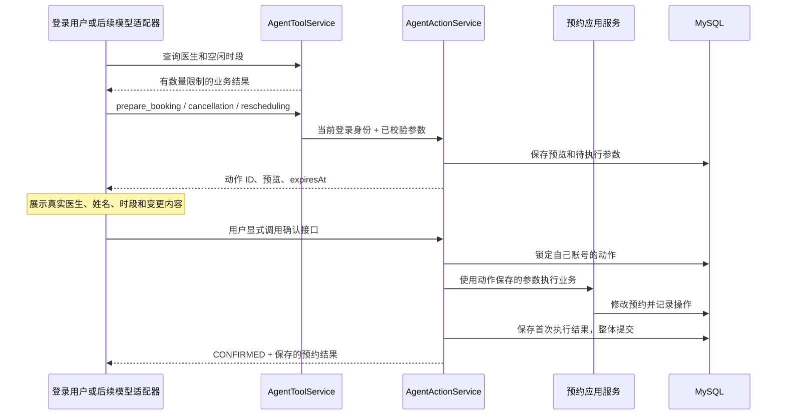

# Agent 工具与动作确认

业务能力封装成模型可以调用的十个函数工具。可以通过 HTTP 测试工具，也可以由 Spring AI Alibaba ReactAgent 调用 `AgentToolService`。启用方式见 [DeepSeek 对话说明](deepseek-chat.md)，可恢复改期见 [Graph 说明](spring-ai-alibaba-graph.md)。自动化测试使用模拟模型，不调用收费 API。

## 当前调用流程



查询不会修改预约。三个 `prepare_*` 工具只创建动作预览，既不占住时段，也不取消或移动原预约。确认接口独立于工具目录，后续模型不会获得“确认”工具。

## 工具目录

先登录取得 Bearer 令牌，再请求 `GET /api/agent/tools`。返回数组中的每一项形如：

```json
{
  "type": "function",
  "function": {
    "name": "get_doctor",
    "description": "按医生 ID 查询医生信息。",
    "parameters": {
      "type": "object",
      "additionalProperties": false,
      "properties": {
        "doctorId": {"type": "integer", "minimum": 1, "maximum": 9223372036854775807, "description": "医生 ID"}
      },
      "required": ["doctorId"]
    }
  }
}
```

工具定义采用 Chat Completions 的函数工具结构。DeepSeek 适配器使用目录作为请求的 `tools`，把返回的函数名和 JSON 参数交给本地分发器，查询结果再作为 `tool` 消息回传。官方结构见 [DeepSeek API 文档](https://api-docs.deepseek.com/api/create-chat-completion/)。没有依赖提供方的严格模式；无论模型输出什么，服务器都会校验参数。真实模型调用需要在服务器配置并启用。

| 工具名 | 必填参数 | 可选参数 | 返回内容 |
| --- | --- | --- | --- |
| `search_doctors` | 无 | `name`、`page`、`size` | 医生分页；姓名按包含关键词匹配，`%`、`_` 作为普通字符 |
| `get_doctor` | `doctorId` | 无 | 医生详情 |
| `search_available_slots` | `doctorId` | `page`、`size`、`from`、`to` | 指定医生未来且空闲的时段分页 |
| `search_appointments` | 无 | `page`、`size`、`status`、`customerName`、`from`、`to` | 当前账号有权查看的预约分页 |
| `get_appointment` | `appointmentId` | 无 | 有权查看的预约详情 |
| `get_appointment_history` | `appointmentId` | `page`、`size` | 有权查看的预约操作记录分页 |
| `prepare_booking` | `customerName`、`slotId` | 无 | 新预约动作预览 |
| `prepare_cancellation` | `appointmentId` | 无 | 取消动作预览，保存预览时的时段 |
| `prepare_rescheduling` | `appointmentId`、`expectedSlotId`、`targetSlotId` | 无 | 原预约与目标时段的改期预览 |
| `start_rescheduling_workflow` | `appointmentId`、`from`、`to` | `doctorId`，省略使用原医生 | 候选时段、流程 ID 和 revision，等待用户选择与确认 |

分页默认 `page=0`、`size=20`，每页 1～100 条，`page * size` 不得超过 `Integer.MAX_VALUE`。分页与总数在数据库中计算，工具不会先加载整个列表再截断。医生按 `id` 排序，空闲时段按 `startTime, id` 排序。

查询时间必须是带时区的 ISO 8601 字符串，条件是开始时间的半开区间 `[from, to)`；省略或传 `null` 表示该边界不限。姓名和状态等可选筛选条件也可以为 `null`。`page`、`size` 和必填 ID 不能为 `null`。数字必须是 JSON 整数，不能用字符串、浮点数或超出范围的值代替。未知字段、未知工具名会返回 400。

改期流程工具的 from、to 必填且不能为 null，范围最长 31 天；doctorId 可省略，不能为 null。选择、确认、刷新、结束流程都不在模型工具目录中。流程关联动作通过流程确认接口执行，不能用普通动作确认接口绕过；撤回状态为 REVOKED。

`search_available_slots` 只返回未来且当前没有 `BOOKED` 预约的时段，取消记录不占用时段。查询结果不保证稍后仍有空位，确认时会再次检查。

## 先预览，再确认

向 `POST /api/agent/tools/execute` 发送以下内容。`slotId` 必须替换为空闲时段查询返回的真实 ID：

```json
{
  "name": "prepare_booking",
  "arguments": {"customerName": "张三", "slotId": 12}
}
```

响应外层为 `{"name":"prepare_booking","result":{...}}`。动作放在外层 `result` 中，包含：

- `id`：服务器生成的 UUID，用于读取和确认。
- `kind`：`BOOK`、`CANCEL` 或 `RESCHEDULE`。
- `status`：`PENDING`、`CONFIRMED` 或读取时计算的 `EXPIRED`。
- `createdAt`、`expiresAt`、`confirmedAt`：UTC 时间，默认五分钟有效。
- `preview`：`summary`、原预约 `before` 和目标预约 `after`。医生、时段与时间从业务服务查询，不相信模型生成的医生姓名或时间。
- `result`：尚未确认时为 `null`，确认后为首次执行业务得到的预约结果快照。

只有当前账号可以通过 `GET /api/agent/actions/{id}` 读取自己生成的动作。向 `POST /api/agent/actions/{id}/confirm` 发送请求确认，**不需要请求体**。确认读取保存的参数，额外请求体不能覆盖时段、姓名或账号。

这里的双层 `result` 含义不同：工具响应的 `result` 是工具结果；动作对象的 `result` 是确认后保存的业务结果。

## 权限、时效与重试

身份来自登录令牌，并由服务器传入应用服务。工具参数不包含 `ownerId`、`userId`、管理员标记、SQL 或任意 HTTP 地址。普通用户只能通过工具访问自己的预约；管理员沿用业务系统的预约管理权限。动作的读取和确认则始终限定为生成动作的账号，即使其他管理员也不能确认它。

预览不会预留时段。确认时，如果时段已经被抢占、预约已经改到另一个时段或源预约已无法改期，业务服务拒绝执行并保留原状态。取消预览保存预览时的时段，避免用户确认旧预览时意外取消后来改期的预约。预约已经取消时，确认取消按既有规则返回成功且不增加操作记录。

过期的待确认动作返回 409，应重新查询并生成预览。有效期在取得动作锁、接受确认时检查，已接受的确认不会因后续业务锁等待再次过期。数据库保留 `PENDING`，读取时显示 `EXPIRED`；本阶段没有定时清理历史动作。

同一个动作的确认受到行锁保护。重复或并发确认只执行一次，并返回首次保存的结果快照；即使预约后来取消或动作原有效期已过，确认重试仍返回原结果。**如需预约最新状态，调用 `get_appointment`**。两份不同动作仍是两个业务意图，竞争同一时段时最多一份预约成功。

预约变化、操作记录和动作结果共用同一个数据库事务。任意保存失败会整体回滚，动作保持待确认。原有普通 HTTP 创建预约接口不因此自动具备幂等性，这里的重试保证以动作 UUID 为范围。

## 测试与部署

CI 使用真实 MySQL 验证参数和权限、预览无业务副作用、确认与重试、并发抢占、过期、过时预览和结果保存失败的回滚。架构测试保证 `agent` 只调用业务模块的应用层，业务模块不反向依赖 Agent。

新增表由 `V6__add_agent_actions.sql` 创建，不修改历史迁移。更新服务器后，在项目目录运行现有 `sudo python3 scripts/verify_persistence.py`，它会验证待确认动作和已确认结果在应用重启后的保存情况。脚本会重启应用并保留测试数据；不调用模型 API。

## 代码阅读顺序

1. `AgentToolCatalog`：工具名、描述和参数 schema。
2. `AgentToolArguments` 和 `AgentToolService`：拒绝非法参数，明确分发到应用服务。
3. `AgentActionService` 的三个准备方法：把真实业务数据做成预览，保存规范化参数。
4. `confirm`：先锁动作，再调用业务服务，最后保存结果；理解锁和外层事务。
5. `AgentActionsControllerTest` 和 `AgentActionRollbackTest`：阅读并发确认、旧取消预览、占用变化与回滚的实际案例。

对话入口返回文字、调用摘要和服务器生成的待确认动作。生成一份动作后本轮立即停止，后续模型指定的额外调用返回跳过结果。用户确认走独立接口，模型网络请求不会持有数据库事务或行锁。
