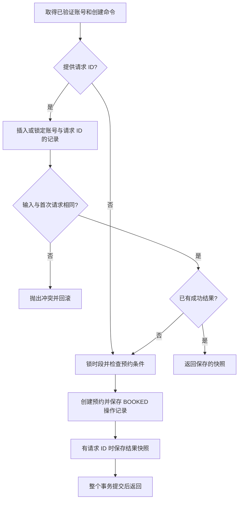

# 创建预约的请求幂等性

一个常见情况：服务器已经创建预约并提交事务，但客户端没收到响应。客户端不知道成功没有，于是重发了一次请求。原来的时段锁能保证不超卖，但第二次请求会得到“时段已被预约”，客户端仍然不知道那条预约是不是自己刚刚创建的。

现在客户端可以给 `POST /api/appointments` 增加 `Idempotency-Key` 请求头。重试沿用同一个值，服务器就能返回首次成功的预约结果，不重复创建预约或操作记录。

## 从 HTTP 请求看起

```http
POST /api/appointments
Authorization: Bearer <登录得到的令牌>
Idempotency-Key: 8a34c966-642c-4bfc-8c5e-d73837ae2c20
Content-Type: application/json

{"customerName":"张三","slotId":12}
```

`slotId` 要换成实际存在的未来时段。一次新的创建意图生成一个新的 UUID；网络重试、重复点击同一次提交应复用该 UUID，不能每次发送时重新生成。

| 输入或场景 | 结果 |
| --- | --- |
| 没有 `Idempotency-Key` | 保持原有创建行为，不启用请求重放 |
| 提供的键为空、不是完整 UUID，或使用缩写 UUID | 400 / `INVALID_ARGUMENT` |
| 同账号、同键、相同姓名和时段 | 返回首次成功的 201、预约 JSON 与 `Location` |
| 同账号、同键，换姓名或时段 | 409 / `CONFLICT`，不创建另一条预约 |
| 同账号、不同键，抢同一个时段 | 按原有规则，最多一个成功，另一个返回时段冲突 |
| 不同账号使用同一个键 | 分别处理，不能读到别人的响应；管理员也遵守这个范围 |
| 首次创建失败 | 整个事务回滚，不保留此键；可以修正输入或等时段释放后重试 |

姓名先去掉首尾空格再比较，大小写仍严格区分；UUID 的字母统一为小写。`"  张三  "` 与 `"张三"` 是同一内容，`"Alice"` 与 `"alice"` 是不同内容。

这里保存的是**首次成功结果的快照**。即使后来取消、改期或时段已经开始，重试原请求仍返回当时的结果，不重新执行业务。要看最新状态，调用 `GET /api/appointments/{id}`；要取消后重新预约，使用新键。这也解释了为什么重放仍返回 201。

## 接口里的两个注解分别做什么

在 [AppointmentController](../src/main/java/com/op1ed/appointmentmanager/appointment/web/AppointmentController.java) 中：

```java
@AuthenticationPrincipal UserIdentity caller
@RequestHeader(value = "Idempotency-Key", required = false) String requestId
```

前一个参数取得 Spring Security 已验证的账号，决定请求属于谁；后一个参数读取客户端提供的请求标识，没有提供时是 `null`。它们只把需要的信息交给业务服务，去重本身由 `AppointmentServiceImpl` 和数据库完成。

HTTP 请求体仍是 `customerName + slotId`。Controller 将请求体和请求头合为 [BookAppointmentCommand](../src/main/java/com/op1ed/appointmentmanager/appointment/application/BookAppointmentCommand.java)，命令统一校验输入。账号 ID 始终由服务端身份传入。

## 事务里发生了什么



这些步骤都在 `AppointmentServiceImpl.create` 的 `@Transactional` 内执行。私有 `createBooking` 方法负责原有预约逻辑，直接沿用外层事务，不另开事务。

新表 `appointment_booking_requests` 的唯一约束是 `(owner_id, request_id)`。首次请求用 INSERT 占住这个组合；重复请求遇到唯一键冲突时走下面的 SQL：

```sql
INSERT INTO appointment_booking_requests (...)
VALUES (...)
ON DUPLICATE KEY UPDATE id = id;
```

这条 UPDATE 保留原值，同时获取更新锁。前一个事务还没结束时，后一个请求需要等待；然后通过 `SELECT ... FOR UPDATE` 读取最新记录。MySQL 对该语句的重复键分支使用排他锁，具体规则见 [MySQL 8.4 锁说明](https://dev.mysql.com/doc/refman/8.4/en/innodb-locks-set.html)。

- 前一个事务提交：后一个读到已保存结果，直接返回。
- 前一个事务回滚：它插入的请求记录也消失，后一个请求可以插入并正常创建。
- 两次输入不同：后一个读到首次输入后返回冲突，不能覆盖它。

不能通过这条 SQL 的“影响行数”判断是否首次请求，因为不改变数据的更新，其返回值受连接选项影响。因此代码总是继续锁定读取记录，再判断是否已有快照。参见 [MySQL 的 affected rows 说明](https://dev.mysql.com/doc/refman/8.4/en/insert-on-duplicate.html)。

锁顺序是**先请求记录，再目标时段**。请求去重阶段只有写入和锁定读取，避免在等待时段锁之前建立普通查询快照，导致后面的占用检查读取过期数据。请求表中的 `slot_id` 保存输入，不添加时段外键；时段是否存在由预约业务校验，也避免外键检查提前获取时段共享锁。

## 为什么结果也要放在同一个事务

如果预约单独提交，结果快照稍后保存，那么应用在两步之间失败时，重试只能看到“时段已占用”，仍无法重放结果。

当前把请求记录、预约、操作记录和结果快照作为一个整体提交。任何一步失败都回滚，数据库不会留下已提交的“处理中”记录。程序也不需要在内存中记住哪些请求执行过。

本阶段只保存成功结果，暂不清理这些记录；保证范围是记录保留期间。每个成功且带键的创建请求增加一条记录，重试不会增加新记录。未来增加保留期限时，需要同时约定过期键能否重新使用。

## 按顺序读这些文件

1. [AppointmentController](../src/main/java/com/op1ed/appointmentmanager/appointment/web/AppointmentController.java)：请求头、身份和请求体如何组合。
2. [BookAppointmentCommand](../src/main/java/com/op1ed/appointmentmanager/appointment/application/BookAppointmentCommand.java)：姓名、时段 ID 和 UUID 的输入校验。
3. [AppointmentServiceImpl](../src/main/java/com/op1ed/appointmentmanager/appointment/application/impl/AppointmentServiceImpl.java)：先看 `create` 的三个步骤，再看 `createBooking`。
4. [AppointmentBookingRequest](../src/main/java/com/op1ed/appointmentmanager/appointment/domain/AppointmentBookingRequest.java)：保存哪些输入和结果，怎样比较请求。
5. [AppointmentBookingRequestMapper](../src/main/java/com/op1ed/appointmentmanager/appointment/infrastructure/persistence/mapper/AppointmentBookingRequestMapper.java) 和 [V9 迁移](../src/main/resources/db/migration/V9__add_booking_request_idempotency.sql)：唯一约束和加锁 SQL。
6. [幂等性集成测试](../src/test/java/com/op1ed/appointmentmanager/appointment/AppointmentBookingIdempotencyTest.java) 与 [回滚测试](../src/test/java/com/op1ed/appointmentmanager/appointment/AppointmentEventRollbackTest.java)：观察两个请求、尚未提交的事务和故障注入。

Agent 仍使用已有的动作 ID 和确认事务实现重放，不要求模型生成这个请求头，也没有增加绕过用户确认的入口。

## 部署与验证

本次只新增 Flyway V9，V1～V8 的内容不变。对应提交的 CI 通过后，在服务器项目目录拉取代码并重新构建应用；Flyway 会自动增加新表。

```bash
git pull --ff-only
sudo docker compose up -d --build app
sudo python3 scripts/verify_persistence.py
```

验证脚本会创建测试数据并重启 app 容器。新增检查包括创建请求重放、操作记录不重复，以及取消后的原创建响应在应用重启后仍能重放。脚本在实际服务器运行成功后，才能确认该次部署通过重启验证。
