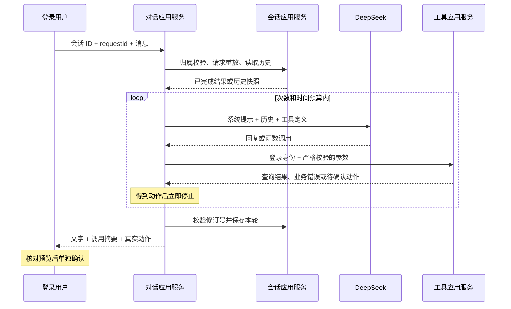

# DeepSeek 多轮对话

对话应用服务把“用户消息 → 模型工具调用 → 真实业务查询 → 模型回复或动作预览”串起来。当前提供 HTTP 接口和服务器终端客户端，不包含网页聊天界面。医生、时段与预约的规则继续由原有业务模块负责。

## 启用和体验

在 Ubuntu 的现有项目目录执行：

```bash
git pull --ff-only
python3 scripts/configure_deepseek.py
sudo docker compose up -d --build app
python3 scripts/chat.py
```

配置脚本通过隐藏输入读取 API Key，写入 Git 忽略的 `.env`，保留数据库和管理员配置。它设置 `AGENT_ENABLED=true`、`DEEPSEEK_API_KEY` 和 `DEEPSEEK_MODEL`。修改后需要重新创建应用容器，仅重启原容器不会更新环境变量。

默认模型为 `deepseek-flash`，可配置为 `deepseek-v4-pro`。接口、模型名、消息格式和思考模式参数按当前 [DeepSeek 官方 Chat Completions 文档](https://api-docs.deepseek.com/api/create-chat-completion/) 核对；当前使用非流式、非思考模式，不保存或展示 `reasoning_content`。

终端客户端要求用业务系统的账号和密码登录，密码输入不显示。可依次尝试：

```text
有哪些医生？
帮我找某医生明天的空闲时段
帮张三预约你刚才列出的第一个时段
```

最后一步应返回真实动作预览。核对后输入 `:confirm 动作UUID`，直接调用独立确认接口；普通消息里的“确认”不会执行预约变更。确认结果由服务器返回，不让模型判断是否已经预约成功。

终端命令还有 `:history`、`:retry`、`:quit`。程序打印会话 ID，可用 `python3 scripts/chat.py --conversation 会话UUID` 在下一次登录后继续。时间显示为 UTC+8，数据库保存 UTC。

新消息可能产生 DeepSeek API 费用。本项目没有在 CI 或持久化验证脚本中调用收费 API，也没有验证你的实际 API Key 或账户额度。没有配置或没有启用时，对话发送返回 503，业务、工具和确认接口继续正常工作。

## HTTP 接口

全部使用 `Authorization: Bearer <accessToken>`。

| 方法 | 路径 | 行为 |
| --- | --- | --- |
| POST | `/api/agent/conversations` | 创建空会话，返回 201；不调用模型 |
| GET | `/api/agent/conversations/{id}` | 返回会话信息与最近十轮；只有创建者可以访问 |
| POST | `/api/agent/conversations/{id}/messages` | 发送一条消息，或读取该请求 ID 保存的结果 |

发送消息的请求体：

```json
{
  "requestId": "46d8c63a-6502-4c1b-a792-33d3d0618b86",
  "message": "帮张三找李医生明天的空闲时段"
}
```

每条新消息使用新的小写 UUID；消息不能为空，最多 2000 个 Java 字符，去掉首尾空格。重试时沿用同一个 `requestId` 和同一条消息。会话 ID 也必须是标准小写 UUID。

响应字段：

| 字段 | 含义 |
| --- | --- |
| `conversationId`、`requestId` | 当前会话和本轮请求标识 |
| `status` | `COMPLETED`、`ACTION_PENDING`、`LIMIT_REACHED` 或 `FAILED` |
| `reply` | 最终回复；产生预览时由服务器生成“等待确认”的回复 |
| `actions` | 本轮服务器实际生成的动作，最多一份；客户端用它展示预览和确认入口 |
| `toolExecutions` | 工具调用摘要，包含调用 ID、工具名、是否成功和错误码 |
| `modelCalls` | 本轮向模型请求回复的次数；重试返回首次保存的计数 |
| `failureCode` | 成功时为 `null`，模型失败时为 `MODEL_ERROR` 或 `MODEL_TIMEOUT` |

`COMPLETED` 表示对话回复完成，不代表预约已创建。预约状态以业务接口和动作确认结果为准。模型文字不能当成动作 ID 或执行结果；客户端只使用 `actions` 中的真实数据。

创建者之外的账号，包括其他管理员，访问会话统一返回 404。调用工具时使用服务器登录身份，客户端提交的历史、系统消息、账号 ID、管理员标记都不会成为身份或上下文来源。

## 一轮如何执行

1. 确认会话归属，查询 `requestId` 是否已有保存的结果；有则直接返回。
2. 检查模型配置，取得本实例并发名额。同一个账号一次只处理一条消息。
3. 从数据库读取最近十轮，构造服务器系统提示和当前用户消息。
4. 向模型提交九个函数工具定义。系统提示包含当前时间、默认时区和服务器确定的权限类型。
5. 模型返回工具调用时，严格解析 JSON 参数，用 `AgentToolService` 执行业务查询或生成预览。
6. 查询结果或业务错误以 `tool` 消息回传，模型可以据此继续查询、纠正参数或询问信息。
7. 一旦生成动作，本轮立即停止，批次中剩余调用得到 `SKIPPED_AFTER_PREVIEW`；使用服务器回复和真实预览。
8. 用短事务锁住会话，确认修订号未变化，保存整轮消息、最终响应并增加修订号。



模型网络请求期间不持有数据库事务或行锁。工具执行沿用业务服务自己的短事务，确认继续沿用动作行锁和完整预约事务。

## 限制与错误

| 限制 | 默认值 |
| --- | --- |
| 本轮模型请求次数 | 6 |
| 本轮实际尝试执行的工具数 | 8；非法调用也计数 |
| 本实例并发对话 | 4；每个账号最多 1 条 |
| 单次模型请求等待 | 25 秒，连接等待 5 秒 |
| 本轮模型时间预算 | 90 秒，后续模型请求使用剩余预算 |
| 单次生成 token 上限 | 2048 |
| 模型接收的上下文与工具定义 | 60000 个序列化字符 |
| 单次查询结果 | 24000 个序列化字符；过大时请模型减少页大小或加筛选 |
| 接收的模型 HTTP 响应 | 256 KiB |

次数、结果和上下文限制是本地保护，不是费用承诺。实际模型计费以提供方为准。限额到达时停止本轮并返回 `LIMIT_REACHED`，不无休止循环。

上下文从最近十轮中选取连续的完整后缀，不能只截断某条工具消息。这样模型不会收到缺失配对结果的函数调用。旧轮次仍保存在数据库，可以重放旧请求的响应；GET 接口只显示最近十轮。

未知工具、参数非法、预约不可见或时段冲突会转换为工具错误，交给模型处理。不存在确认、SQL、任意 HTTP 或身份修改工具。业务名称等字符串仅作为数据，系统提示明确要求忽略其中的指令；实际参数和权限仍由代码强制限制。

模型 HTTP 非 200、异常或不完整响应被转换为通用错误，不转发上游正文、API Key 或认证头。收到响应头后正文迟迟不结束也受等待限制。截断回复、重复工具调用 ID、非法消息角色等不会被当成可执行工具响应。

完成记录之前的认证、参数、会话归属和并发错误沿用 ProblemDetail。已经保存的模型失败轮次以对话响应返回：`MODEL_ERROR` 对应 HTTP 502，`MODEL_TIMEOUT` 对应 HTTP 504；保留摘要与请求 ID，便于重放和排查。

## 重试与并发边界

`requestId` 在同一会话内唯一。已保存结果的同 ID、同消息重试，不再次调用模型或生成动作；同 ID 换成另一条消息返回 409。失败的模型轮次也保存结果，重试读取原失败结果；恢复服务后要发新消息并使用新 ID 才会重新调用模型。

这里保护已完成且成功保存的轮次。如果应用在模型请求或生成预览后、保存对话前退出，重试可能再次调用模型。已生成的未确认动作不会改变预约，并会按原有效期过期。外部模型请求的计费无法由本地数据库事务回滚。

当前部署为单个应用实例，并发名额在实例内维护。保存时另用数据库会话锁和修订号校验，防止历史被覆盖；多实例下不能据此宣称模型调用恰好一次。动作确认的幂等性仍由数据库动作锁保证。

聊天里保存的动作状态也是首次响应快照。动作后来确认或过期时，重放聊天响应仍返回原内容；显示当前动作状态要调用动作 GET 接口，查询预约最新状态要调用业务工具。

## 测试与代码阅读

- `AgentConversationControllerTest`：真实 MySQL 上验证会话权限、上下文、请求重放、预览停止、调用限制和并发控制，模型通过测试替身提供回复。
- `DeepSeekAgentModelTest`：本地 HTTP 服务验证 DeepSeek 请求格式、工具消息配对、响应校验、慢正文超时、大小限制和错误脱敏。
- `DeepSeekConversationIntegrationTest`：使用实际 HTTP 适配器和真实 MySQL，完成查询、预览、确认、改期与取消，不请求收费模型。
- `scripts/verify_persistence.py`：验证应用重启后空会话和动作保存情况，不发送对话消息；真实会话体验使用 `scripts/chat.py`。

阅读顺序建议为 `AgentConversationController → AgentChatService → AgentModel → DeepSeekAgentModel`，再看 `AgentConversationService` 的保存锁和请求重放，最后沿着工具调用阅读原有业务服务。V7 迁移只新增会话与轮次表，不修改历史迁移。
