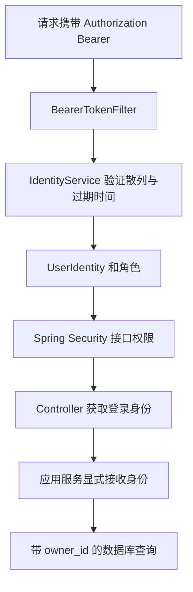

# 身份、登录与预约权限

本轮解决两个问题：请求来自哪个账号，以及这个账号能操作哪些记录。预约人姓名仍是业务资料，不能作为登录身份或权限依据。

## 账号和角色

`identity` 模块拥有账号和令牌表，对外提供 `UserIdentity`。公开注册永远创建 `USER`，客户端传入的角色字段不会赋予管理员权限。`ADMIN` 由服务器初始化配置创建。

用户名去首尾空格、转小写，再验证 3～50 位英文字母、数字、下划线和连字符。数据库使用唯一约束，两个同时注册的请求最多只有一个成功。密码不裁剪、不转大小写；至少 8 个字符，UTF-8 后最多 72 字节。

密码通过 Spring Security 的 `BCryptPasswordEncoder` 散列并存储，每次编码包含随机盐。数据库和 API 都不保存或返回可还原的密码。[Spring Security 密码存储说明](https://docs.spring.io/spring-security/reference/6.5/features/authentication/password-storage.html)

## 登录与退出

1. `LoginRequest` 转为 `LoginCommand`，先校验输入。
2. `IdentityService.login` 读取账号并用 PasswordEncoder 校验密码。未知账号也执行一次密码散列校验，并与错误密码返回相同错误。
3. 生成 32 字节安全随机数，转换为 URL 安全的访问令牌。
4. 数据库保存令牌的 SHA-256 散列、账号 ID、UTC 过期时间。登录响应返回原始令牌、Bearer 类型、过期时间与用户资料。
5. 退出时删除当前令牌的散列记录，其他登录令牌继续有效。

令牌默认有效 24 小时，不提供刷新令牌；过期后重新登录。令牌数据在 MySQL 中，应用重启后仍有效。已经进入业务流程的请求不会因稍后的退出而被回溯中断。

这里使用数据库访问令牌，没有实现 JWT、OAuth 授权服务器或第三方登录。它适合当前单体项目，撤销行为直接可见；代价是受保护请求需要访问数据库验证令牌。已过期的记录仍留在表中，后续可增加清理任务。

## 请求如何取得身份

`BearerTokenFilter` 位于 HTTP 适配器中，只在 Spring Security 过滤链注册。它验证令牌后建立当前请求的安全上下文。HTTP 不使用登录 Cookie、HTTP Basic 或 Session，认证凭证必须显式放在 Authorization 请求头中，因此当前 API 关闭 CSRF。若将来增加 Cookie 登录，需要重新设计这项配置。[认证架构](https://docs.spring.io/spring-security/reference/6.5/servlet/authentication/architecture.html)、[会话配置](https://docs.spring.io/spring-security/reference/6.5/servlet/authentication/session-management.html)

Controller 用 `@AuthenticationPrincipal` 取得 `UserIdentity`，再显式传给应用服务。业务层不读取 `SecurityContextHolder`，不接受请求或模型传入的角色标记。[接口授权说明](https://docs.spring.io/spring-security/reference/6.5/servlet/authorization/authorize-http-requests.html)

## 接口权限和记录权限

| 操作 | 匿名 | USER | ADMIN |
| --- | --- | --- | --- |
| 注册、登录、查询医生和时段 | 允许 | 允许 | 允许 |
| 创建医生、发布时段 | 401 | 403 | 允许 |
| 创建预约 | 401 | 绑定本人账号 | 绑定本人账号 |
| 查询和取消预约 | 401 | 仅本人 | 全部记录 |

接口权限由 Spring Security 检查；应用服务也保护管理员写操作和预约归属，所以以后 Agent 调用同一个业务入口仍需满足权限。

创建预约从已认证的身份取得 `owner_id`。请求的 `customerName` 可表示家人姓名，但不能改变归属；客户端提交 `ownerId` 或 `administrator` 不会改变服务器的决定。

普通用户分页查询时，Repository 的记录查询和 countQuery 都强制包含 `owner_id = 当前账号`。在数据库分页前完成过滤，避免当前页或总数泄漏其他用户信息。详情和取消使用 `findByIdAndOwnerId`，他人的 ID 与不存在的 ID 都返回相同的 404。

历史预约保留，V4 之前没有 owner_id 的记录只能由管理员查看和取消。系统不按同名自动归属历史记录。

## 管理员初始化与部署

服务器在 `.env` 中配置 `ADMIN_USERNAME`、`ADMIN_PASSWORD`，Compose 传为 `APP_ADMIN_USERNAME`、`APP_ADMIN_PASSWORD`。`AdministratorBootstrap` 在迁移完成后调用身份服务：账号不存在时创建管理员；已有管理员时保留原密码；若账号已属于普通用户，拒绝启动，要求更换初始化用户名。

`scripts/configure_admin.py` 交互读取密码，不打印、也不把密码放到命令行参数。数据库配置被保留，已有完整管理员配置不会覆盖。修改初始化配置不等于修改数据库账号密码。

`scripts/verify_persistence.py` 登录管理员，验证预约、取消、重新预约和重启后的令牌持久化，不打印密码或令牌。应用仍只绑定服务器回环地址；以后对外开放时使用 HTTPS。

## 阅读顺序

1. [UserIdentity](../src/main/java/com/op1ed/appointmentmanager/identity/application/UserIdentity.java)：业务层需要的身份信息与管理员检查。
2. [IdentityService](../src/main/java/com/op1ed/appointmentmanager/identity/application/IdentityService.java)：注册、密码校验、令牌验证和退出。
3. [SecurityConfiguration](../src/main/java/com/op1ed/appointmentmanager/identity/web/security/SecurityConfiguration.java) 与 [BearerTokenFilter](../src/main/java/com/op1ed/appointmentmanager/identity/web/security/BearerTokenFilter.java)：接口权限和请求身份。
4. [AppointmentService](../src/main/java/com/op1ed/appointmentmanager/appointment/application/AppointmentService.java) 与 [AppointmentRepository](../src/main/java/com/op1ed/appointmentmanager/appointment/infrastructure/persistence/AppointmentRepository.java)：归属如何参与记录与总数查询。
5. [V4 迁移](../src/main/resources/db/migration/V4__add_accounts_tokens_and_appointment_owners.sql)：账号、令牌、外键和归属索引。
6. [权限集成测试](../src/test/java/com/op1ed/appointmentmanager/identity/AuthAndOwnershipControllerTest.java)：同名隔离、伪造字段、401/403/404、过期和撤销、并发注册。

未来 Agent 工具接收服务端注入的身份，再调用应用服务。工具参数只描述预约业务，不能包含让模型自行决定的账号 ID 或管理员权限。
