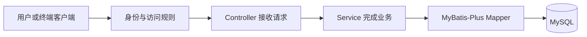

# 从全局重新认识这个项目

这份文档是整个项目的阅读起点。我们按当前代码分批学习，每批把相关文件的注释补齐，读完再进入下一批。

**当前阅读进度：全局、医生和身份模块已基本读过，先补看 MyBatis-Plus 的数据库访问方式。** 从熟悉的医生查询和账号注册出发，阅读 [MyBatis-Plus 迁移说明](mybatis-plus-migration.md)，再进入时段与预约。身份模块不熟悉的请求认证部分可结合 [身份说明](identity-and-permissions.md) 回顾。

## 1. 这个系统解决什么问题

这是一个医生预约后端，提供 HTTP 接口和终端聊天客户端。

一条完整业务主线是：管理员创建医生 → 给医生发布可预约时段 → 用户注册、登录 → 查询时段并预约 → 根据需要取消或改期 → 查询操作记录。

先分清三个业务对象：

| 对象 | 例子 | 作用 |
| --- | --- | --- |
| 医生 Doctor | 王医生 | 保存医生资料 |
| 时段 AppointmentSlot | 王医生明天 14:00～14:30 | 描述医生什么时候可以接受预约 |
| 预约 Appointment | 张三预约了这个时段 | 保存谁预约、预约哪个时段及当前状态 |

“发布时段”和“创建预约”是两次操作。管理员先发布时段，用户才有可选的 slotId。一个时段最多有一条有效预约；取消后，符合时间条件的时段可以再次被预约。

另外有登录账号 UserAccount。预约里的 customerName 是预约人姓名，登录账号决定这条预约的归属和访问权限。姓名相同的两个账号不会因此共享预约。

Agent 在这套业务之上增加自然语言入口。例如用户说“帮我看看明天下午有没有号”，模型请求工具查询医生和时段。真正的查询和预约规则仍由业务服务处理。生成预览后，用户需要单独确认；自定义 Graph 进一步把改期拆成可以暂停、恢复的步骤。

## 2. 先记住项目的两层划分

第一层按业务划分，目录都在 `src/main/java/com/op1ed/appointmentmanager` 下：

| 目录 | 它负责什么 | 典型文件 |
| --- | --- | --- |
| doctor | 医生资料的创建、查询 | DoctorController、DoctorService、Doctor |
| appointment | 时段、预约、取消、改期、操作记录 | SlotService、AppointmentService、Appointment |
| identity | 注册、登录、令牌、管理员和身份验证 | AuthController、IdentityService、BearerTokenFilter |
| agent | 对话、工具、预览、确认和改期流程 | AgentChatService、AgentActionService、SpringAiReschedulingGraph |
| shared | 共用参数规则、错误、持久化配置 | BusinessException、GlobalExceptionHandler、MybatisConfiguration |

第二层在每个业务目录里区分职责：

| 子目录 | 阅读时把它理解成 | 主要工作 |
| --- | --- | --- |
| web | 请求入口 | 接收 HTTP、读取参数、调用应用服务、返回 JSON |
| application | 用例执行者 | 完成一次业务操作，组织校验、事务和其他服务调用 |
| domain | 业务对象 | 表达医生、预约、时段及对象自身的规则 |
| infrastructure/persistence/mapper | 数据库访问 | Service 直接调用 Mapper，执行 SQL 和申请数据库锁 |

这是“模块化单体”：所有业务在一个 Java 应用里运行，使用同一个 MySQL。包目录表达职责和调用边界；当前没有把它们拆成多个独立服务。

## 3. 一个请求如何穿过项目

以后每读一段代码，都沿着具体请求追踪：

例如 `GET /api/doctors/7` 查询编号为 7 的医生。这是公开查询，可以先用它理解最短的调用链：

1. `SecurityConfiguration` 配置允许公开查询医生。
2. `DoctorController.getDoctor` 从路径中取得 7，调用 `DoctorService.requireById(7)`。
3. Service 查询并检查医生是否存在，返回业务结果 DoctorInfo；不存在则抛业务异常。
4. Service 直接调用 `DoctorMapper`，MyBatis-Plus 执行 SQL 访问 doctors 表，Doctor 映射查询结果。按主键查询与插入来自 `BaseMapper`，分页和行锁 SQL 在 Mapper 文件中。
5. Controller 把 DoctorInfo 转成 DoctorResponse，Spring 将响应转换为 JSON。

这条链对应已读的第二批（医生模块），可以用来复习各层之间如何配合。

Agent 工具也会调用 Service。因此权限、占用检查和事务放在业务服务中，可以供 HTTP 和 Agent 共用。

## 4. 第一批的三个代码入口

按顺序打开，文件中的中文注释与这里对应：

1. [pom.xml](../pom.xml)：声明 Java 版本、使用哪些库、如何构建。先认识 Web、安全、数据库、迁移、测试和 Agent 这几组依赖的用途。
2. [AppointmentManagerApplication.java](../src/main/java/com/op1ed/appointmentmanager/AppointmentManagerApplication.java)：main 方法启动整个应用；Spring 找到 Controller、Service 等组件并组装它们。
3. [application.properties](../src/main/resources/application.properties)：配置数据库连接、MyBatis-Plus 映射、令牌和 Agent 等参数。先读数据库与登录配置，Agent 参数留作后面批次的索引。

把三者串起来：Maven 根据 pom.xml 准备依赖并构建应用 → Java 从 main 进入 Spring Boot → 启动过程加载配置、组装组件并连接数据库 → 应用处理 HTTP 请求。

数据库结构由 `src/main/resources/db/migration` 下的 Flyway 迁移管理。启动时执行尚未执行的迁移；MyBatis-Plus 负责已有表的数据读写。当前通过真实 MySQL 集成测试检查映射与 SQL，已移除 Hibernate 的结构校验。已执行迁移的内容保持稳定，后续结构变化通过新迁移增加。

代码更新与服务器运行也分开理解：本地修改 → 推送 GitHub → Actions 编译测试 → 服务器拉取代码 → Docker Compose 构建、启动 app 和 db。GitHub 测试通过后，服务器还需要更新部署。

## 5. 后续分批路线

先把业务底座读顺，再进入 Agent。下面每一行是一批；涉及较多代码时可以继续拆小。

| 批次 | 主题 | 读完应能说明什么 |
| --- | --- | --- |
| 1，已读 | 全局地图、依赖、启动和配置 | 项目做什么、各层在哪、程序如何启动 |
| 2，已读 | 医生查询与创建 | 一个简单请求如何经过 Controller、Service、Mapper 和实体 |
| 3A，已读 | 注册与登录 | 账号怎样保存、密码怎样校验、登录怎样发出令牌 |
| 3B，已基本读过 | 令牌验证、退出和权限 | 后续请求怎样确定当前用户、哪些操作需要管理员 |
| **3C，当前** | MyBatis-Plus 的数据访问 | Service 怎样调用 Mapper，新增、更新和数据库事务怎样执行 |
| 4，下一批 | 发布时段与查询可用时段 | 医生和时段如何关联，如何检查时间重叠 |
| 5 | 创建预约与并发占用 | 如何防止两个人同时约到同一时段，事务与锁各做什么 |
| 6 | 取消、改期和操作记录 | 状态怎样变化，失败怎样回滚，重复操作如何处理 |
| 7 | Agent 工具、预览与确认 | 业务服务怎样变成工具，模型能做哪些操作 |
| 8 | 多轮会话、DeepSeek 和 ReactAgent | 一条消息怎样触发模型与工具调用，再保存历史 |
| 9 | 改期 StateGraph 与检查点 | 在哪里暂停、如何恢复、如何处理冲突和重复确认 |

之前的 V1～V8 迁移记录了数据库从基本预约逐步增加医生时段、账号、操作记录、Agent 动作、会话和 Graph 的过程。当前源码已经包含这些能力，我们按上面的业务关系阅读当前版本。

## 第一批的回顾问题

下面三个问题用于回顾项目的全局结构：

1. 医生、时段、预约、登录账号分别代表什么？
2. 接到请求后，Controller、Service、Mapper 各做哪部分工作？
3. pom.xml、启动类、application.properties 分别管什么？

详细架构约定在 [architecture.md](architecture.md)。后续读到具体业务时再结合它查阅。
