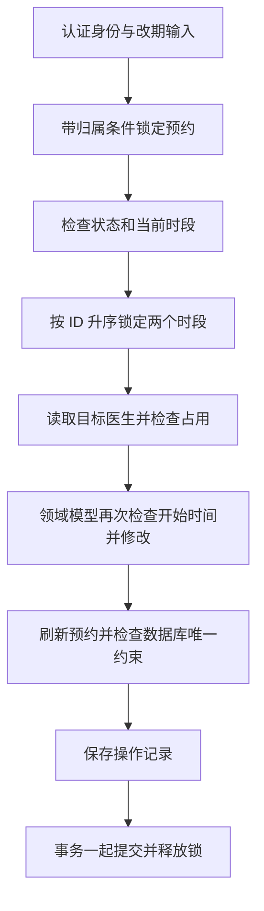

# 预约改期与操作记录

这轮增加两个业务入口：`POST /api/appointments/{id}/reschedule` 与 `GET /api/appointments/{id}/history`。它们仍经过身份认证，普通用户操作本人预约，管理员可以操作其他账号和旧记录。调用方不能通过请求指定账号归属或操作人。

## 改期是什么

一条有效预约从时段 A 移到时段 B，预约 ID、预约人姓名、账号归属与 `BOOKED` 状态保持。医生姓名与起止时间更新为目标时段的信息，允许跨医生改期。原时段释放与目标时段占用一起提交，任一检查或记录保存失败，整个事务回滚。

请求包含 `expectedSlotId` 和 `targetSlotId`，都是正整数。前者是调用方刚查询到的当前时段，后者来自真实的时段查询。已取消的预约、没有时段的旧练习记录不能改期。真正移动时，原预约和目标时段都必须尚未开始；目标还必须空闲。

当前已处于目标时段时返回当前预约，不重新移动、不再追加记录。其他情况下，当前时段与 `expectedSlotId` 不同会返回 409，要求重新查询。两个从同一原时段出发、指向不同目标的并发请求只有一个成功；相同目标的并发重试返回同一结果。

这是当前时段的比较保护。它不记录请求的唯一标识，也不提供任意历史请求重放的结果；如果预约后来再次改期，应先重新查询，不能把旧请求当作通用幂等键重复使用。

## 事务与锁的顺序

取消与改期都先锁预约，再锁时段，保证同一预约的修改串行执行。锁定预约时同时过滤账号归属；在等待另一个操作后，使用当前读取得最新状态。两个时段按 ID 升序加锁，避免交叉改期时分别持有相反时段而互相等待。

创建预约仍先锁目标时段，再检查占用并插入新预约；它不会锁定已有预约行。改期与取消也会申请相关时段的锁，因此争抢同一目标时段时会协调执行。占用检查使用普通查询，检查到已有预约就返回冲突；不额外锁住其他预约。

改期的第一个数据库读取是加锁的预约查询，之后先取得两个时段的锁，再做普通医生和占用查询。这个顺序避免 MySQL 默认可重复读事务过早建立快照，导致等待锁后继续读到旧占用状态。MyBatis Mapper 明确执行 `SELECT ... FOR UPDATE`；查询必须处于应用服务的同一个 Spring 事务内，提交或回滚后才释放锁。MyBatis 一级缓存设为 `STATEMENT`，锁定读不复用上一次 SQL 的对象结果。数据库的锁定读语义见 [MySQL 8.4](https://dev.mysql.com/doc/refman/8.4/en/innodb-locking-reads.html)。

数据库的 `active_slot_id` 生成列与唯一索引继续限制一个时段只有一条有效预约。锁组织业务检查与并发行为，数据库约束提供最后一道一致性检查。

## 操作记录保存什么

V5 创建 `appointment_events`，每条记录保存：

| 字段 | 含义 |
| --- | --- |
| `appointment_id` | 被操作的预约 |
| `actor_id` | 真实执行操作的登录账号；管理员代操作时记录管理员 |
| `action` | `BOOKED`、`RESCHEDULED` 或 `CANCELLED` |
| `from_slot_id` | 操作前占用的时段；创建时为空 |
| `to_slot_id` | 操作后占用的时段；取消时为空 |
| `occurred_at` | 服务器记录的 UTC 时间，微秒精度 |

记录与业务修改共用一个事务。它不是异步消息，也没有单独开启新事务。业务 SQL 已刷新后，若记录保存抛出异常，预约修改仍会被回滚。

记录只在真正变更时追加；重复取消和已经到达目标时段的改期不再追加。历史查询以预约可见性为前提，在数据库中分页，`page` 从 0 开始，`size` 为 1～100，按记录 ID 升序排序，并提供当前预约历史的总数。其他人的预约与不存在的预约同样返回 404。

这张表记录操作人和时段变化，不保存每个字段的完整版本，也不负责从事件重建预约。V5 上线之前的操作无法确认，历史为空是允许的；以后对旧预约的合法操作会开始留下记录。

## 怎么验证

集成测试通过真实 HTTP 与 MySQL 检查：

- 跨医生改期保留 ID、姓名和归属，原时段可再次预约。
- 目标被占用、不存在、已经开始，或原预约已取消、已经开始时保留原数据。
- 同一预约的不同改期请求、相同请求重试、多个预约争抢目标、交叉改期。
- 改期与创建预约或取消同时发生时，最终占用与状态一致。
- 普通用户无法操作或查询他人的历史，客户端伪造操作人不会影响记录。
- 模拟记录存储异常，检查已刷新到数据库的创建、改期和取消都回滚。

服务器的 `scripts/verify_persistence.py` 额外验证应用重启后的预约、登录令牌与操作记录。GitHub CI 验证代码，服务器脚本验证实际部署；当前流程仍需要手动更新服务器。

## 阅读顺序

1. [RescheduleAppointmentCommand](../src/main/java/com/op1ed/appointmentmanager/appointment/application/RescheduleAppointmentCommand.java) 和 [AppointmentHistoryQuery](../src/main/java/com/op1ed/appointmentmanager/appointment/application/AppointmentHistoryQuery.java)：业务入口如何验证输入。
2. [AppointmentService](../src/main/java/com/op1ed/appointmentmanager/appointment/application/AppointmentService.java)：锁顺序、归属、事务、改期与记录保存。
3. [Appointment](../src/main/java/com/op1ed/appointmentmanager/appointment/domain/Appointment.java)：模型如何拒绝不允许的改期，并保留账号与姓名。
4. [AppointmentMapper](../src/main/java/com/op1ed/appointmentmanager/appointment/infrastructure/persistence/mapper/AppointmentMapper.java) 和 [V5](../src/main/resources/db/migration/V5__add_appointment_events.sql)：加锁查询、外键与历史分页索引。
5. [并发集成测试](../src/test/java/com/op1ed/appointmentmanager/appointment/AppointmentRescheduleControllerTest.java) 与 [回滚测试](../src/test/java/com/op1ed/appointmentmanager/appointment/AppointmentEventRollbackTest.java)：读取最终数据库状态，理解并发请求允许的结果。

以后 Agent 可以查询预约与可用时段，取得 `expectedSlotId` 后提交改期。身份由服务端注入，工具仍调用同一个应用服务；操作记录可以用于展示执行结果和排查失败。
