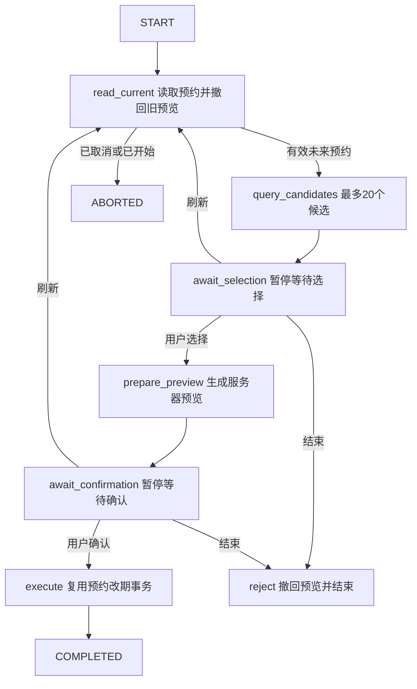

# Spring AI Alibaba 与改期 Graph

项目使用 [Spring AI Alibaba](https://github.com/alibaba/spring-ai-alibaba) 的 `ReactAgent` 和 `StateGraph`。依赖固定为 `spring-ai-alibaba-agent-framework:1.1.2.2`，Spring AI BOM 为 `1.1.2`；继续使用 Java 21、Spring Boot 3.5.16。以本项目版本和编译通过的代码为准，其他版本示例的 API 可能不同。

## 两种流程的职责

ReactAgent 处理“理解用户 → 查询业务 → 回复或创建预览/流程”。模型根据工具结果选择下一步查询。原来 `AgentChatService` 的手写循环已移除，现在由框架执行。

StateGraph 处理“读预约 → 查候选 → 等待选择 → 生成预览 → 等待确认 → 执行改期”。这组顺序、权限和确认条件由程序决定。Graph 节点调用已有业务服务，节点本身不调用模型。

例如“把我的预约改到明天下午”：ReactAgent 先澄清预约、日期、医生和时间范围，再调用 `start_rescheduling_workflow`。服务器查候选并暂停；用户选时段后生成真实预览，再次暂停；只有用户独立确认才移动预约。时段被别人占用时，重查候选并重新等待选择与确认。

## 先读 ReactAgent 接入

阅读顺序：`AgentRuntime` → `SpringAiAgentRuntime` → `DeepSeekChatModelAdapter` → `SpringAiMessages` → `DeepSeekAgentModel` → `SpringAiAgentRuntimeTest`。

应用层依赖 `AgentRuntime` 端口。适配层每轮创建独立的 ReactAgent、工具回调、登录身份和预算计数。`DeepSeekChatModelAdapter` 实现标准 `ChatModel`，保留已验证的 HTTP 适配器：超时、认证头、正文上限和响应格式校验。模型提供方仍为 DeepSeek。

| 框架 API | 本项目的用途 |
| --- | --- |
| `ReactAgent.builder().model().tools()` | 组装模型和受限业务工具 |
| `ToolCallback` | 使用目录中的 JSON schema，交给 `AgentToolService` 执行 |
| `ModelHook.beforeModel`、`JumpTo.end` | 检查预算；得到预览或流程后结束本轮 |
| `ToolInterceptor` | 跳过批次中的后续调用，保留调用 ID 与结果配对 |
| `parallelToolExecution(false)` | 串行执行业务工具，确保预览后停止 |
| `RunnableConfig` | 独立运行配置；非流式模型请求设置 `_stream_=false` |

## 自定义 Graph



`SpringAiReschedulingGraph` 用 `addNode`、`addEdge`、`addConditionalEdges` 定义流程，`interruptBefore("await_selection", "await_confirmation")` 设置暂停点。恢复时 `updateState` 写入用户信号，再从检查点继续。在 1.1.2.2 中会继续执行暂停的等待节点，再按 signal 分支。

状态键显式登记为 `KeyStrategy.REPLACE`。这个版本恢复时只导入注册过的键，遗漏 signal 或业务参数会丢失恢复信息。检查点只存 JSON 字符串、数字；登录身份放在当次 metadata 中，每次由服务端重新注入。

阅读顺序：`WorkflowCommands` → `ReschedulingWorkflowService` → `ReschedulingWorkflowTransactions` → `SpringAiReschedulingGraph` → `ReschedulingWorkflowOperations` → `JpaWorkflowCheckpointSaver`。依次看用例输入、事务边界、节点与分支、节点业务、持久化。

## API 与客户端

接口需要 Bearer 登录。流程只对创建者可见，管理员也不能操作别人创建的流程。

| 请求 | 请求体 | 作用 |
| --- | --- | --- |
| `POST /api/agent/rescheduling-workflows` | `requestId, appointmentId, from, to`；可选 `doctorId` | 创建，201 + Location |
| `GET /api/agent/rescheduling-workflows/{id}` | 无 | 最新状态、候选、预览、revision |
| `POST .../{id}/selection` | `requestId, expectedRevision, targetSlotId` | 选择保存的候选 |
| `POST .../{id}/confirm` | `requestId, expectedRevision` | 确认当前预览 |
| `POST .../{id}/refresh` | `requestId, expectedRevision` | 撤回旧预览，重新查询 |
| `POST .../{id}/reject` | `requestId, expectedRevision` | 撤回预览并结束 |

requestId 为客户端生成的标准小写 UUID。时间必须带时区，区间为 `[from, to)`，最长 31 天，最多展示最早的 20 个候选。无候选时为 `NO_CANDIDATES`，允许刷新或结束；调整时间范围、医生需要新建流程。

服务器运行 `python3 scripts/chat.py`。可以通过聊天启动流程，也能直接输入以下命令验证 Graph，无需模型 Key。日期换成实际未来日期：

```text
:workflow-start 预约ID 2030-01-01T13:00:00+08:00 2030-01-01T18:00:00+08:00
:workflow-show 流程UUID
:workflow-select 流程UUID 候选时段ID
:workflow-confirm 流程UUID
:workflow-refresh 流程UUID
:workflow-reject 流程UUID
:workflow-retry
```

确认需要已展示相同 revision 的预览。状态变化时客户端先展示最新内容，等待再次确认。网络中断后 `:workflow-retry` 重放上一次流程请求的 ID 和参数。流程命令不调用模型；普通聊天消息可能调用付费 DeepSeek API。

## 持久化与事务

V8 新增流程、请求响应日志和检查点表，动作新增 `workflow_id`、`REVOKED`。`JpaWorkflowCheckpointSaver` 没有进程内缓存，每次从 MySQL 读取。它必须在 Spring 事务内调用，与业务变更共用事务。

一次推进一起提交：Graph 检查点、预览状态、预约与操作记录、流程 revision、请求响应日志。任何一步出错，全部回滚。单独保存 Graph，而让预约独立提交，会留下流程状态与预约不一致的问题。

推进先按 owner + 主键锁住流程，再查请求日志和 revision。使用 `READ_COMMITTED`，让业务服务取得时段锁后的占用查询看到最新提交；否则外层的请求日志查询可能提前建立 MySQL 旧快照。预约与时段的既定加锁顺序、占用唯一索引仍生效。

业务冲突抛出 `WorkflowBusinessConflict`。事务外 Service 等待失败事务完整回滚，再开启恢复事务，撤回旧预览、读最新预约、重查候选。恢复结果保存为原请求的响应；不会自动替用户改选或执行。

requestId 在账号内唯一。同 ID、同操作、同参数重放首次响应；改变参数、操作或流程返回 409。新请求携带旧 revision 也返回 409。日志和聊天中的响应是历史快照，查询当前状态要 GET 流程。

模型工具使用服务器生成的请求 ID。聊天已经保存后的重试直接重放聊天结果；如果流程已创建而聊天未保存就崩溃，重试可能创建另一条未确认流程，预约仍未执行。不能据此宣称外部模型计费或调用恰好一次。

旧 `prepare_rescheduling` 单次预览仍可用。Graph 关联动作必须通过流程确认接口执行；普通动作确认拒绝绕过流程，刷新和结束使旧预览进入 REVOKED。

## 验证

框架单元测试使用真实 ReactAgent、StateGraph。CI 使用 MySQL 检查权限、请求重放、revision、并发确认、候选被抢占、过期预览、外部改期、执行后故障回滚，以及重新构造 Graph、Saver 和事务服务后从数据库恢复。模拟模型 HTTP 测试覆盖聊天入口到 Graph 工具。

`sudo python3 scripts/verify_persistence.py` 在服务器创建待确认流程、重启 app、恢复并确认，检查重试不增加操作记录。它不调用模型，会保留测试数据。CI 通过后仍需拉取代码并重建服务器容器。

当前范围是单实例部署、单条预约改期、两个用户暂停点。先理解框架执行、暂停恢复和事务一致性，再扩展复杂场景。
